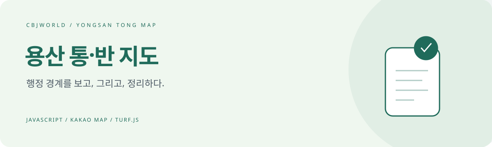

# 용산 통·반 지도 · Yongsan Tong Map

**통·반 경계와 필지를, 하나의 지도 작업 공간에서.**

용산구의 통·반 경계를 조회하고 편집하는 지도 도구입니다. 경계를 직접 그리거나 필지 단위로 배정하고 JSON으로 저장·불러올 수 있습니다.

`JavaScript` · `Kakao Maps` · `Turf.js` · `Python build`

### [→ 기존 배포 화면](https://yongsan-tong-map.vercel.app)

배포 화면에는 접속 확인이 있습니다. 공개 데이터와 코드 예시는 아래 구성 및 실행 방법으로 살펴볼 수 있습니다.

## 두 개의 작업 화면

| 조회 뷰어 `index.html` | 경계 편집기 `editor.html` |
| --- | --- |
| 동·통·반 경계와 목록 확인 | 경계 그리기와 필지 배정 |
| 저장된 데이터 조회 | JSON 내려받기·불러오기 |

## 기본 사용 흐름

1. 동을 선택하고 기존 경계를 확인합니다.
2. 편집기에서 경계를 조정하거나 필지를 통·반에 배정합니다.
3. 결과를 JSON으로 내보냅니다.
4. 뷰어에서 데이터를 불러와 결과를 확인합니다.

GitHub 데이터 저장 기능을 설정한 경우 저장소의 `data/` 파일을 통해 변경 내용을 공유할 수 있습니다.

## 로컬에서 준비하기

```bash
git clone https://github.com/cbjworld/yongsan-tong-map.git
cd yongsan-tong-map
```

`build.py`의 카카오 지도 키·저장소 경로 설정을 확인합니다. **개인 액세스 토큰을 코드나 생성된 HTML에 넣지 마세요.**

```bash
python build.py
python -m http.server 8000
```

`http://localhost:8000`에서 조회 화면, `/editor.html`에서 편집기를 엽니다. 카카오 개발자 콘솔에는 사용할 도메인을 등록하세요. `index.html`과 `editor.html`은 생성 결과이므로 화면 수정은 `src/` 템플릿에서 작업한 뒤 다시 빌드합니다.

## 구조

| 경로 | 역할 |
| --- | --- |
| `src/viewer_template.html` | 조회 화면 원본 |
| `src/editor_template.html` | 편집 화면 원본 |
| `src/all_dong_boundaries.json` | 동 외곽선 |
| `src/parcels_by_dong.json` | 필지 데이터 |
| `data/` | 저장소에서 공유하는 통·반 데이터 |
| `build.py` | HTML 생성 |

## GitHub 데이터 연동

`build.py`에서 소유자·저장소·브랜치·데이터 경로를 지정하면 뷰어가 해당 JSON을 읽도록 구성할 수 있습니다. 편집기에서 개인 토큰을 입력하는 기능은 있지만, 공개 HTML에 토큰을 내장하면 방문자가 읽을 수 있습니다. 필요한 저장소에만 권한을 제한하고 비밀값을 커밋하지 마세요. 브라우저에 저장된 토큰은 공유 PC에서 사용 후 정리하세요.

## 접근 설정과 데이터 정확도

정적 HTML의 비밀번호 화면은 서버의 접근 제어가 아닙니다. 공개 저장소에 있는 데이터는 소스로 읽을 수 있으므로 비공개 업무 데이터나 개인정보를 넣지 마세요. 현재 공개 데이터의 완전성과 정확도를 보장하지 않으며, 경계는 공식 자료와 대조해 확인해야 합니다.

## 알려진 제한사항

- 남영동, 보광동, 원효로2동, 이촌1동, 한강로동, 효창동 6개 동은 아직 정밀 경계가 아니라
  기존의 단순화된(점 25~100개 수준) 경계선을 쓰고 있습니다. 지적 필지를 합쳐서 다시
  계산해봤을 때 기존 대비 면적 차이가 커서(-25%~+57%), 정확도를 확신할 수 없어 임시로
  기존 경계를 유지했습니다. 국가공간정보포털/브이월드에서 정확한 행정동 경계 파일을
  구해서 `src/all_dong_boundaries.json`을 교체하는 게 가장 확실합니다.
- 통/반/필지 데이터는 한남동만 실제 값이 채워져 있고, 나머지 15개 동은 통/반 경계가
  비어있는 상태로 시작합니다 (기본 외곽선과 필지 데이터는 16개 동 모두 있음).

## 함께 개선해요

유용했다면 **⭐ Star**로 응원해 주세요. [Issues](https://github.com/cbjworld/yongsan-tong-map/issues)에 오류 재현 방법이나 개선 아이디어를 남겨주시면 도움이 됩니다. 예시 자료에서 개인정보와 비공개 데이터는 제거해 주세요.

**English:** A Kakao Maps and Turf.js workspace for viewing and editing neighborhood boundaries and assigning land parcels in Yongsan, Seoul. Includes JSON import/export and a Python build script.
